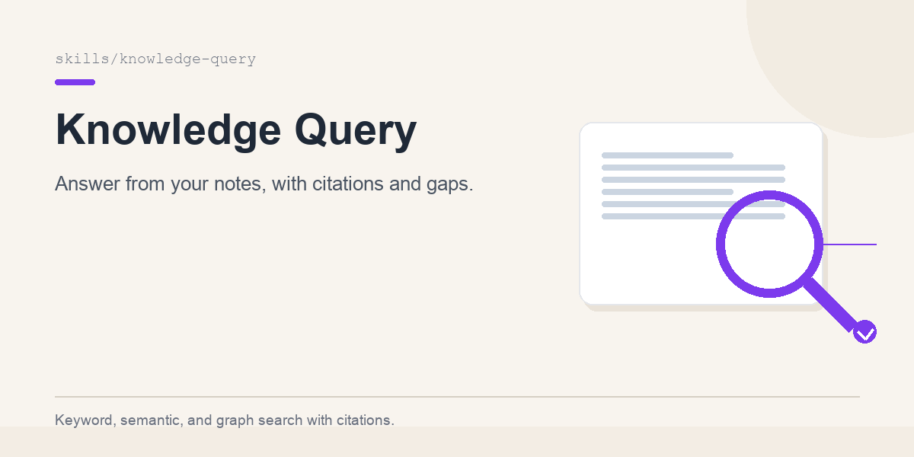

# knowledge-query

<p align="center">
  
</p>

Answer questions from a markdown knowledge base with grounded citations, explicit gaps, and conflict handling.

## What it does

- Decomposes a question into keyword, semantic, and graph searches.
- Reads the smallest useful chunks before loading full pages.
- Synthesizes an answer with `[Source: slug, section, updated date]` citations.
- Flags gaps, stale pages, and conflicting sources.
- Produces daily briefings and brain-augmented research.

Plain markdown + `rg`. Optional [gbrain](https://github.com/garrytan/gbrain) for hybrid semantic search and graph traversal.

## When to use

- "What do we know about X?"
- "Search my notes / my brain for Y"
- "Who is X?" / "How are A and B connected?"
- "What happened with X?"
- "Give me a briefing for today"
- "Research this using my notes plus the web"
- Any answer that must be traceable to sources

## Install

```bash
export KB_ROOT="${KB_ROOT:-$HOME/brain}"
rg --version          # ripgrep
jq --version          # optional, for --json output
```

Optional gbrain:

```bash
# Install per https://github.com/garrytan/gbrain
gbrain query "what do we know about pricing?"
```

## Usage

```bash
# Keyword search
bash scripts/search.sh "pricing experiment" --limit 20

# Filter by frontmatter type
bash scripts/search.sh "Jane Doe" --type person

# Files only
bash scripts/search.sh "annual-only" --files-only

# Machine-readable
bash scripts/search.sh "annual-only" --json
```

With gbrain:

```bash
gbrain query "why did we choose annual-only pricing?"
gbrain graph-query people/jane-doe --depth 2 --direction both
gbrain briefing --date 2026-05-21
```

## Answer shape

```md
## Answer
Annual-only pricing was approved for the next experiment.

## Evidence
- The decision was recorded on 2026-05-21 [Source: meetings/2026-05-21-pricing-review, Decisions, updated 2026-05-21].
- The prior monthly-first note is older [Source: inbox/2026-03-02-1a2b3c4d, updated 2026-03-02].

## Gaps and conflicts
- No data yet on the effect on monthly retention.
- Conflict: monthly-first (March) vs annual-only (May); the May decision supersedes.

## Next step
- Capture the retention analysis when the experiment ends.
```

## File layout

```
knowledge-query/
├── SKILL.md
├── README.md
├── references/
│   ├── search.md
│   ├── citations.md
│   ├── briefing.md
│   └── research.md
└── scripts/
    └── search.sh
```

## Known gotchas

| Gotcha | Fix |
|---|---|
| Confident answer with no citation | Treat it as a draft; go back to search |
| No hits because of wording | Try synonyms, exact phrases, and folder names |
| Two pages disagree | Show both citations; do not average |
| Page is stale | Flag the date; prefer newer evidence |
| Search returns inbox noise | Filter by `--type` or folder; triage the inbox |
| External research overwrites notes | Label external facts and capture the source separately |
| No answer exists | Say so and offer to capture the missing source |

## Pairs with

- `knowledge-capture` — fill the gaps you find.
- `knowledge-maintenance` — fix stale pages, orphans, and broken links.

## Credits

- Query contract, source precedence, citation rules, briefing structure, and research workflows adapted from [gbrain](https://github.com/garrytan/gbrain) (MIT, Copyright (c) 2026 Garry Tan).

## License

MIT
